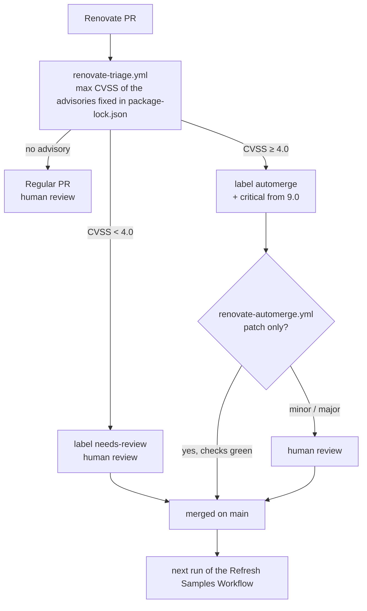

# Dependency updates (Renovate)

Dependencies are kept up to date by the hosted [Mend Renovate](https://developer.mend.io/github/algoan/fake-open-banking-data)
app, configured in [`renovate.json`](../renovate.json); Dependabot alerts stay on. Security fixes
are routed by the CVSS of the vulnerabilities they fix, with the shared actions of
[`algoan/renovate-security-actions`](https://github.com/algoan/renovate-security-actions), the same
flow as `algoan/pubsub` and `algoan/nestjs-components`.
The **hotfix flow is off**: nothing is deployed or published from this repository.

## What happens after a merge

Nothing is released: the **Refresh Samples Workflow** rebuilds the samples and the PDF statements
on `main` with the merged dependencies. It runs on weekdays at noon (UTC), and on a push to `main`
that changes the scripts. A merge by the automerge (`GITHUB_TOKEN`) starts no workflow, so its
fix shows in the samples at the next scheduled run; run the workflow by hand to get it sooner.

## What Renovate updates

| Manager          | Files                                  |
| ---------------- | -------------------------------------- |
| `npm`            | `package.json` and `package-lock.json` |
| `nvm`            | `.nvmrc`                               |
| `github-actions` | `.github/workflows/*.yaml`             |

Routine updates are grouped into one weekly PR (Monday before 6am, Europe/Paris); majors come on
the same schedule, one PR each. A new npm version is only proposed once it is 3 days old
(`security:minimumReleaseAgeNpm`), and `minimumReleaseAgePackageManagerSync` gives npm the same
wait, so the weekly lockfile maintenance skips younger transitive versions too. Lockfile
maintenance runs weekly too.

`algoan/renovate-security-actions` updates come in their own weekly PR
(`algoan renovate-security-actions`), for a human review: it runs the triage and the automerge.

Security PRs are opened immediately at the **lowest fixing version**
(`vulnerabilityFixStrategy: lowest`), without the release-age wait. They keep the range of the
dependency and raise its floor (`rangeStrategy: bump`, e.g. `^0.3.13` → `^0.3.14`).

Not scored by the triage:

- GitHub Actions advisories: such a security PR gets `needs-review` at CVSS unknown;
- packages left unscored by a GitHub API rate limit: the triage comment lists them with the reset
  time, and the automerge doesn't merge the PR. Re-run the triage after that time.

## Routing

- **`renovate-triage.yml`** (`pull_request_target`) scores the packages changed in
  `package-lock.json` with the GitHub Advisory Database. The highest CVSS decides the tier. For a
  security PR it sets the `security` label plus `automerge` or `needs-review` (and `critical` from
  9.0), and comments the advisories. The PR title stays Renovate's: Renovate rewrites it, and
  recognises a PR closed on purpose by its exact title. The triage runs again when Renovate pushes
  to the PR or adds the `security` label. It only runs for PRs opened by `renovate[bot]`, from the
  base commit: nothing from the PR runs with the write `GITHUB_TOKEN`, which matters on this public
  repository.
- **`renovate-automerge.yml`** merges PRs labelled `automerge` with a merge commit, like the other
  PRs here, with the `GITHUB_TOKEN`: the branch ruleset requires no approval, so no bypass app is
  needed. It recomputes the tier for the head commit, requires every commit to be authored by
  Renovate and signed by GitHub, and only accepts changes to dependency files. Only **patch** bumps
  merge automatically; minor/major wait for a human. Every check of the head commit must be green,
  and these must be present: `Tests` and `Socket Security: Pull Request Alerts`. The triage starts
  it, and it runs again when the `Tests` workflow completes; each run waits up to 8 minutes for the
  checks still running (Socket and CodeRabbit can end after the tests, and their end starts no new
  run), then starts a new run if some still are, three times at most. It never merges a PR with a
  change request or an unresolved thread.
- **Critical fixes (CVSS ≥ 9.0)** take the same path with the `critical` label. Tracking the
  vulnerability (ticket, priority) is up to the apps that use these samples, not to this
  repository.

`Tests` ([`tests.yaml`](../.github/workflows/tests.yaml)) runs on every PR to `main`: the unit
tests, then every generation script of the Refresh Samples Workflow (samples, exports, Linxo test
bank, PDF statements), without committing anything. A dependency update that breaks one of them
fails there, not on `main`.

## Configuration

| Repository variable         | Default                                      | Notes                               |
| --------------------------- | -------------------------------------------- | ----------------------------------- |
| `CVSS_AUTOMERGE_THRESHOLD`  | `4.0`                                        |                                     |
| `CVSS_HOTFIX_THRESHOLD`     | `9.0`                                        | Unused while the hotfix flow is off |
| `AUTOMERGE_REQUIRED_CHECKS` | `Tests,Socket Security: Pull Request Alerts` | Comma-separated check names         |

No secret used. The actions are public: the workflows call them with `uses:`, pinned by commit SHA
with the tag in a comment, which Renovate's `github-actions` manager keeps up to date. No token
reads a private repository, and no key of a GitHub App installed on private repositories reaches
this public one.

Repository settings: Renovate app installed, Dependabot alerts on, merge commits allowed (the
automerge merges like the other PRs). The ruleset must keep requiring no approval, or the
automerge can't merge with the `GITHUB_TOKEN`. It requires no status check either: the automerge
waits for its own list of checks, and a maintainer merging a Renovate PR by hand checks first that
`Tests` and Socket are green. _Allow GitHub Actions to create and approve
pull requests_ isn't needed.
